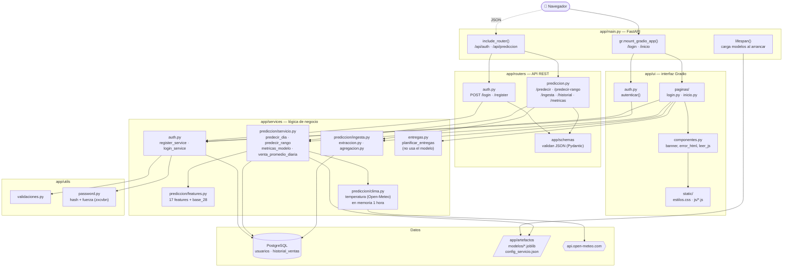
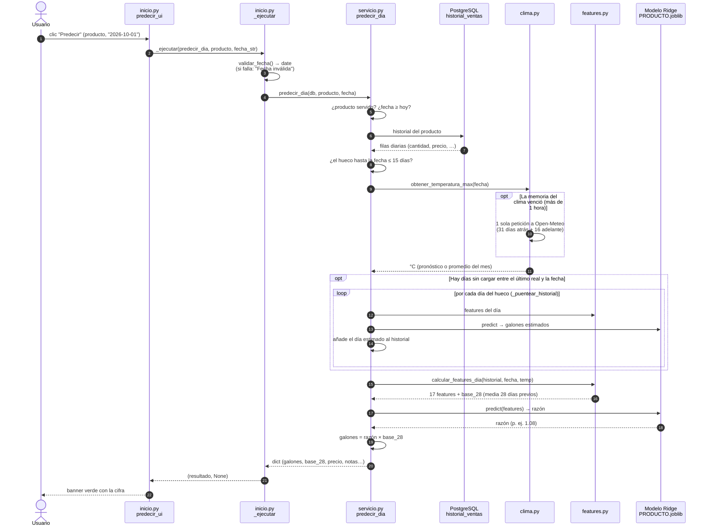
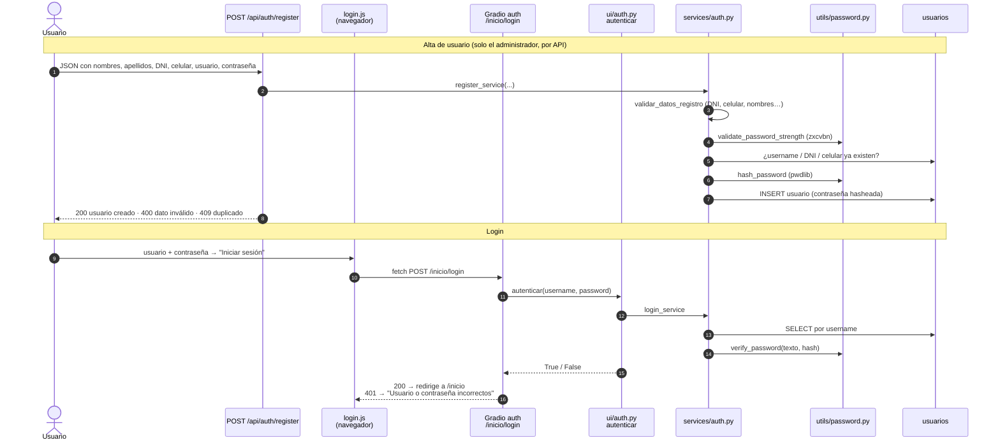
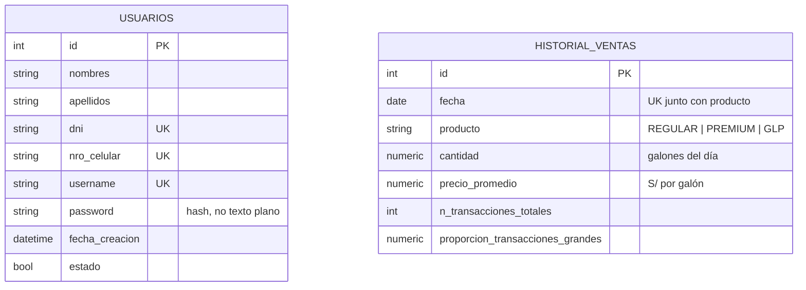
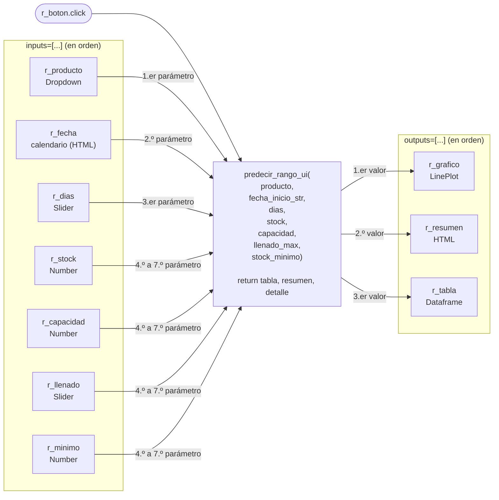
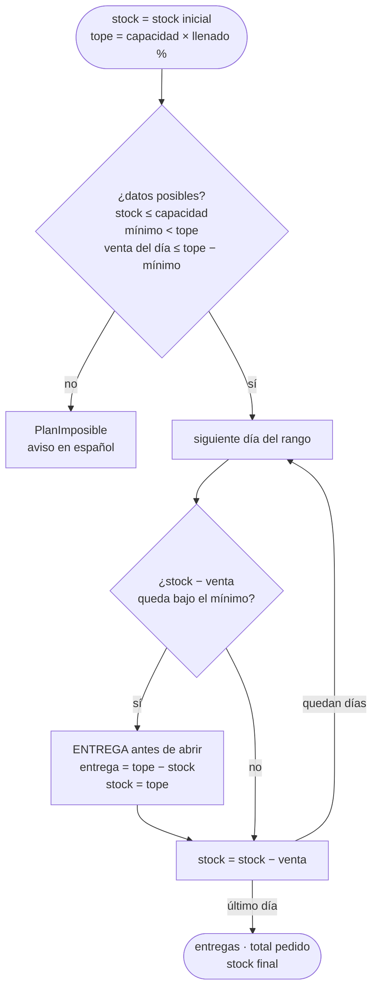

# Arquitectura de BENZIN AI (backend)

Diagramas Mermaid del proyecto. Se ven renderizados en VS Code (vista previa de
Markdown con la extensión *Markdown Preview Mermaid Support*), en GitHub y en
[mermaid.live](https://mermaid.live) pegando cada bloque.

1. [Capas y archivos](#1-capas-y-archivos)
2. [Predicción diaria paso a paso](#2-predicción-diaria-paso-a-paso)
3. [ETL: carga del reporte mensual](#3-etl-carga-del-reporte-mensual)
4. [Login y alta de usuarios](#4-login-y-alta-de-usuarios)
5. [Base de datos](#5-base-de-datos)
6. [Gradio: cómo se conecta un botón con Python](#6-gradio-cómo-se-conecta-un-botón-con-python)
7. [Plan de entregas (stock y capacidad del tanque)](#7-plan-de-entregas-stock-y-capacidad-del-tanque)
8. [Qué ve el usuario y qué no](#8-qué-ve-el-usuario-y-qué-no)

---

## 1. Capas y archivos

Todo corre en un solo proceso FastAPI (`app/main.py`). Hay **dos puertas de
entrada** que llegan a los **mismos servicios**: la UI Gradio (para el encargado del
grifo) y la API REST (para un frontend externo, p. ej. Angular).

**Idea clave para explicar:** la UI y la API son solo "caras". Toda la lógica
está en `services/`, por eso un cambio en cómo se predice afecta a las dos a la vez.

---

## 2. Predicción diaria paso a paso

Qué pasa cuando el usuario elige producto + fecha y aprieta **Predecir**.

**Lo que más preguntan:**

- **¿Qué predice el modelo?** No galones directos: predice la **razón** frente
  al promedio de los 28 días anteriores (`base_28`). Los galones salen de
  `razón × base_28` (`servicio.py`, `_predecir`).
- **¿Por qué 28 días mínimo?** Sin ellos no existe `base_28` → `HistorialInsuficiente`.
- **¿Qué es el "puente"?** El reporte llega mensual; los días sin cargar se
  estiman con el propio modelo (máx. `MAX_HORIZONTE_DIAS = 15`) en vez de
  tratarlos como ceros.
- **Predicción de rango** = el mismo proceso en bucle, un día tras otro, usando
  cada predicción como historial del siguiente.
- **¿Por qué es rápida?** Antes `clima.py` hacía una petición HTTP **por día**
  (~0.7 s cada una): con 10 días de puente eran ~7 s. Ahora una sola petición trae
  47 días y queda en memoria 1 hora (`_temperaturas`, protegida con un `Lock`
  porque Gradio atiende varias peticiones a la vez). Los valores son los mismos que
  día por día. Si Open-Meteo falla, se usa el promedio del mes durante 5 minutos y
  luego se reintenta (antes cada día podía esperar 10 s de timeout).
- **Lo que aún tarda** es la base de datos si se usa el proxy público de Railway
  (~0.35 s por consulta). Desplegado en Railway con la red privada es mucho menor.

---

## 3. ETL: carga del reporte mensual

Única forma en que entran ventas al sistema.

```mermaid
flowchart LR
    xlsx[/"📄 Reporte mensual .xlsx<br/>(sistema del grifo)"/]

    subgraph E["Extract — extraccion.py"]
        e1["extraer_excel()<br/>lee con pandas<br/>verifica columnas requeridas"]
    end

    subgraph T["Transform — agregacion.py + ingesta.py"]
        direction TB
        t1["limpiar_datos()<br/>código artículo → producto<br/>agrupa por día × producto"]
        t2["filtra REGULAR · PREMIUM · GLP<br/>(BIODIESEL se descarta)"]
        t3["días sin ventas → cantidad 0<br/>precio: arrastre (ffill)<br/>desde el lote o la BD"]
        t4["sin precio posible → se omite"]
        t1 --> t2 --> t3 --> t4
    end

    subgraph L["Load — ingesta.py"]
        l1["UPSERT por (fecha, producto)<br/>existe → actualiza<br/>no existe → inserta"]
        l2["db.commit()"]
        l1 --> l2
    end

    db[("historial_ventas")]

    xlsx --> e1 --> t1
    t4 --> l1
    l2 --> db
```

Entradas al ETL:

- **UI:** pestaña "Cargar ventas mensuales" → `cargar_xlsx_ui` → `ingerir_ventas_mensuales`
  (archivos ordenados por nombre para que los meses entren en orden).
- **API:** `POST /api/prediccion/ingesta`.

**Idempotente** = subir el mismo mes dos veces no duplica filas, las actualiza
(gracias al `UniqueConstraint(fecha, producto)` + el upsert).

---

## 4. Login y alta de usuarios

La UI **no** tiene página de registro: el sistema es solo para el administrador del
grifo y un formulario público dejaría a cualquiera con el enlace crear cuenta y ver
las predicciones. Las cuentas se crean con `POST /api/auth/register`.

Toda la API REST (`/api/auth/*` y `/api/prediccion/*`) exige el header `X-API-Key`
con el valor de la variable `API_KEY` (`app/core/seguridad.py`, aplicado en
`include_router` de `main.py`). Sin la clave responde 401; si el servidor no tiene
`API_KEY` configurada responde 503, así nunca queda abierta por olvido. En `/docs` se
pone con el botón **Authorize**. La UI de Gradio no usa estas rutas (llama a los
servicios directo), así que el login y `/inicio` funcionan igual.

**Bloqueo por intentos fallidos** (`ui/auth.py`): tras 5 contraseñas erradas
seguidas, ese usuario queda bloqueado 15 minutos aunque luego acierte. Es por usuario
(Gradio no le pasa la IP a `autenticar`) y vive en memoria: reiniciar el servidor lo
limpia. El mensaje de error es el mismo para clave errada y bloqueo.

La contraseña **nunca** se guarda en texto plano: solo el hash. Al iniciar
sesión se compara con `verify_password`.

---

## 5. Base de datos

Solo dos tablas, sin relación entre sí. Se crean al arrancar con
`Base.metadata.create_all` (`main.py`).

`historial_ventas` guarda datos **crudos** diarios, no features. Las 17 features
se recalculan en cada predicción → si cambia la definición de una feature, no hay
que recargar datos.

---

## 6. Gradio: cómo se conecta un botón con Python

Patrón que se repite en todas las páginas. Ejemplo real de `inicio.py`
(predicción de rango):

Regla: **cada componente de `inputs` entra como parámetro, en orden; cada valor
del `return` va al componente de `outputs`, en orden.** Si agregas un output,
la función tiene que devolver un valor más.

Otro evento del mismo patrón: al salir de un campo de galones (`.blur`), se llama a
`galones_validos` con ese campo como input **y** como output, así un `-5` o un campo
vacío vuelve a `0` en pantalla. No se usa `minimum=0` de Gradio porque deja escribir
el negativo igual y recién al predecir lanza un error en inglés.

---

## 7. Plan de entregas (stock y capacidad del tanque)

Responde **qué día recibir combustible y cuánto**, en la pestaña de rango. Vive en
`app/services/entregas.py`: no usa Gradio ni el modelo, solo recibe la venta
estimada de cada día (`predecir_rango`) y simula el tanque.

Ejemplo (venta de ~71 gal/día, stock 100, tanque de 300 al 100 %): entrega de 271
el día 2 y de 286 el día 6; el tanque cierra la semana con 157.

- **Sin capacidad (0):** no hay plan; se sugiere un solo pedido = venta − stock, más
  una versión "con colchón" que suma el error típico del modelo (MAPE).
- **Llenar el tanque en cada entrega** = menos entregas (menos fletes).
- **Llenado máximo** (por defecto 95 %): los tanques no se llenan al 100 % porque
  el combustible se dilata (el GLP, ≈ 85 %).
- **Stock mínimo:** reserva que nunca se toca; cubre errores del modelo y demoras.
- **Supuesto:** la entrega llega el mismo día, antes de abrir. No se modelan días
  de anticipación del proveedor ni tamaños fijos de cisterna.
- La tabla "Detalle" muestra por día: stock al abrir, entrega, venta estimada y
  stock al cerrar.

---

## 8. Qué ve el usuario y qué no

La UI es para el encargado o el contador del grifo, no para un estadístico.

| Dato | ¿Lo usa el modelo? | ¿Se muestra? | Por qué |
|---|---|---|---|
| Temperatura máxima | sí (feature) | **no** | No sirve para decidir nada y confunde ("¿qué tiene que ver el clima?"). Sigue en la respuesta de la API. |
| 17 features (lags, razones…) | sí | no | Solo en la API, para trazabilidad. |
| Venta diaria promedio del último mes (`base_28`) | sí | sí | Da escala a la cifra predicha. |
| Precio de referencia | sí (congelado) | sí | Contexto. |

**Pestaña de métricas, en lenguaje llano** (`cargar_metricas_ui`):

- El error en galones va **junto a la venta diaria** del producto
  (`venta_promedio_diaria`, últimos 90 días hasta la fecha de entrenamiento) y en %:
  138 galones de error en GLP asustan, pero sobre ~2,900 gal/día son < 5 %.
- En vez de MASE se compara con el **método simple**: repetir lo vendido el mismo
  día de la semana pasada (naive estacional). `metricas_modelo` calcula
  `mejora_vs_simple_pct = (1 − MAE_modelo / MAE_naive) × 100` con los números de
  `config_servicio.json`: REGULAR 21 %, PREMIUM 34 %, GLP 15 % menos error.
- **¿Cómo sé que el modelo acierta en el futuro?** Además de estos 90 días de
  holdout, el notebook `backtesting.ipynb` simula 38 meses pasados como si fueran
  futuro, reentrenando cada mes. Su escenario S3 (bloque ciego, recursivo) es
  exactamente lo que hace la predicción de rango.
